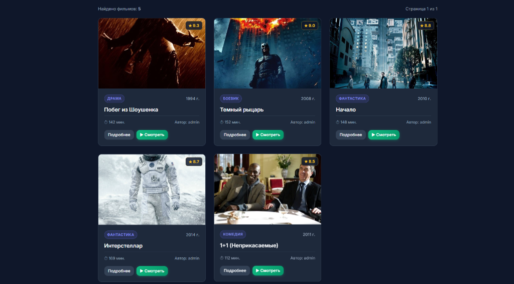
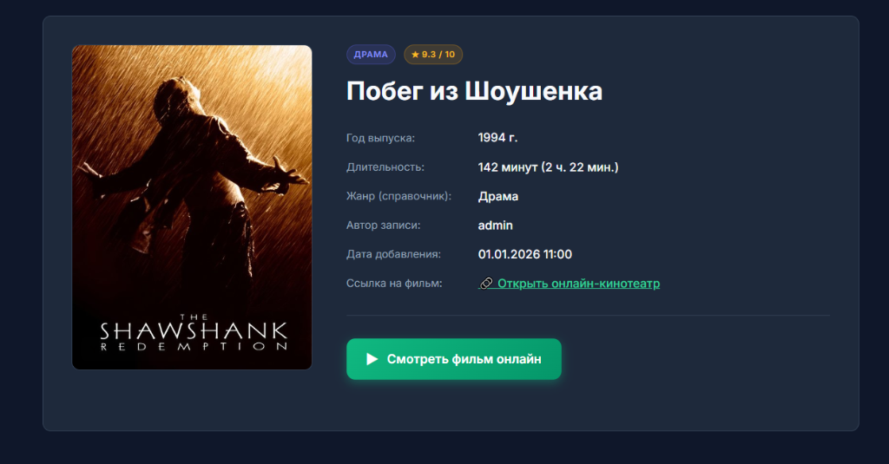
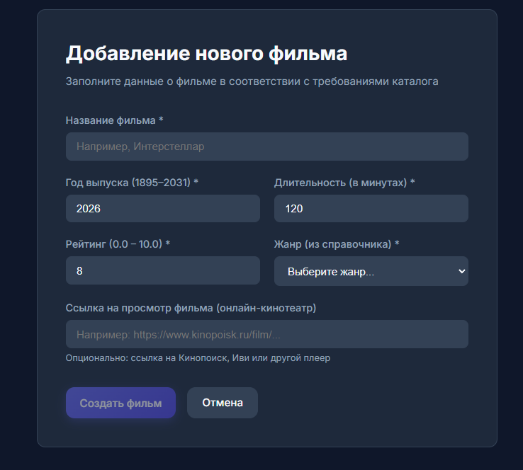
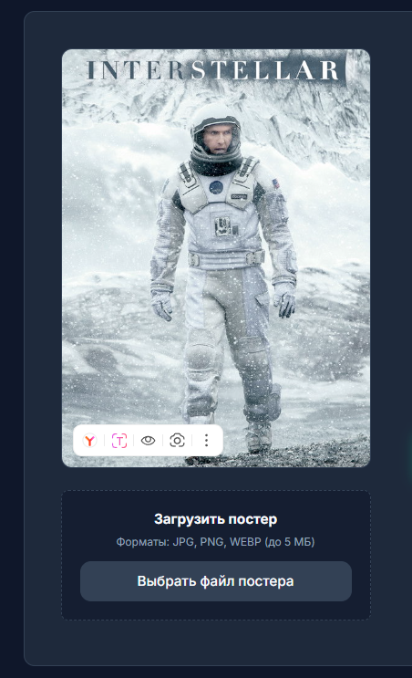

# Каталог фильмов (Movie Catalog)

**Студент:** Ибрагимов А  
**Тема варианта:** Каталог фильмов  
**Сущность Movie:** название, год, длительность, рейтинг (0–10);  
**Справочник:** жанр (связь один-ко-многим);  
**Фильтр:** жанр, рейтинг от, год;  
**Сортировка:** по рейтингу, по году (по возрастанию / по убыванию);  
**Файл:** постер (до 5 МБ, форматы jpg/png/webp, имя на сервере — Guid);  
**Особое правило:** не больше 20 фильмов на одного пользователя (проверяется на сервере).  

---

## 🛠 Стек технологий

* **Backend:** ASP.NET Core Web API (.NET 10), Minimal API, FluentValidation, JWT Bearer, Scalar / OpenAPI UI.
* **Database:** EF Core 10 + SQLite, 2 миграции, сидирование начальных данных (5 фильмов + жанры).
* **Frontend:** Angular 22, Standalone Components, Signals (`signal`, `computed`), `input()` / `output()`, чтение через `httpResource`, Auth Interceptor, Auth Guard.
* **Security:** Хранение паролей в виде хэшей (BCrypt), JWT-токены, секретный ключ в `user-secrets`.

---

## 🔑 Учетные данные для проверки

В базу данных при инициализации добавлены тестовые пользователи:

| Роль | Логин | Пароль | Описание |
| :--- | :--- | :--- | :--- |
| **Тестовый автор** | `admin` | `Admin123!` | Автор 5 начальных фильмов. Имеет права на их редактирование, удаление и загрузку постеров. |
| **Новый пользователь** | `ibragimov` | `Password123!` | Можно зарегистрировать через форму или эндпоинт `/api/auth/register`. |

---

## 🚀 Инструкция по запуску проекта

### 1. Запуск сервера (Backend)

1. Перейдите в папку `server`:
   ```bash
   cd server
   ```
2. Убедитесь, что установлен ключ подписи JWT в `user-secrets` (уже настроен локально):
   ```bash
   dotnet user-secrets set "Jwt:Key" "MovieCatalogSecretSigningKey_2026_Minimum32CharsLong!"
   ```
3. Запустите сервер:
   ```bash
   dotnet run --urls "http://localhost:5000"
   ```
4. Интерактивная документация API (**Scalar**) будет доступна по адресу:
   👉 **http://localhost:5000/scalar/v1**

---

### 2. Запуск клиентской части (Frontend)

1. Откройте второй терминал и перейдите в папку `client`:
   ```bash
   cd client
   ```
2. Установите зависимости (если запускается впервые):
   ```bash
   npm install
   ```
3. Запустите dev-сервер Angular:
   ```bash
   npm start
   ```
4. Откройте веб-приложение в браузере:
   👉 **http://localhost:4200**

---

## 📸 Скриншоты работы приложения

Местоположение скриншотов в репозитории: `docs/screenshots/`

1. **Список фильмов с пагинацией и фильтрами**  
     
   *Показывает карточки фильмов, кнопки «Назад» / «Вперёд», выпадающий список жанров, фильтр рейтинга и сортировку.*

2. **Страница отдельной записи (Детали фильма)**  
     
   *Отображает полную информацию о фильме, постер и кнопки управления (для автора).*

3. **Форма добавления / редактирования с ошибками валидации**  
     
   *Демонстрация работы FluentValidation и формата ProblemDetails (ошибки под полями).*

4. **Загрузка и отображение постера фильма**  
     
   *Загрузка файла только автором записи, сохранение с именем Guid на сервере.*

---

## 🧪 Тестирование API через `.http` файл

В корне репозитория находится файл [MovieCatalog.http](./MovieCatalog.http). В нём подготовлены запросы для всех операций:
- `GET /api/genres` (Справочник)
- `GET /api/movies` (Пагинация, фильтры по жанру/рейтингу/году, сортировка)
- `GET /api/movies/{id}` (Просмотр, 200 OK и 404 Not Found)
- `POST /api/auth/register` (201 Created)
- `POST /api/auth/login` (200 OK + JWT)
- `POST /api/movies` без токена (**401 Unauthorized**)
- `POST /api/movies` с некорректными полями (**400 ProblemDetails**)
- `PUT /api/movies/{id}` чужим пользователем (**403 Forbidden**)
- `POST /api/movies/{id}/poster` (Загрузка файла до 5 МБ)
- `DELETE /api/movies/{id}` (**204 No Content**)

---

## 🎓 Шпаргалка для защиты (Объяснение кода за 10 минут)

Преподаватель может попросить объяснить любые 3 строки кода. Ниже приведен разбор ключевых моментов:

### 1. Особое правило: не более 20 фильмов на пользователя
Файл: `server/Endpoints/MovieEndpoints.cs`
```csharp
var userMoviesCount = await db.Movies.CountAsync(m => m.UserId == userId);
if (userMoviesCount >= 20)
{
    return Results.ValidationProblem(new Dictionary<string, string[]>
    {
        ["MovieLimit"] = ["Достигнут лимит: нельзя создать более 20 фильмов на одного пользователя."]
    });
}
```
* **Объяснение:** Перед вставкой новой записи сервер делает асинхронный запрос `CountAsync` в SQLite по `UserId` текущего авторизованного пользователя. Если количество уже $\ge 20$, сервер прерывает операцию и возвращает HTTP 400 со стандартизированным телом `HttpValidationProblemDetails`.

---

### 2. Разграничение прав: 401 Unauthorized vs 403 Forbidden
Файл: `server/Endpoints/MovieEndpoints.cs`
```csharp
if (movie.UserId != userId)
{
    return Results.Problem(
        statusCode: StatusCodes.Status403Forbidden,
        title: "Forbidden",
        detail: "У вас нет прав на редактирование этого фильма. Только автор может вносить изменения."
    );
}
```
* **Объяснение:** `401 Unauthorized` возвращается автоматически фильтром аутентификации ASP.NET Core, если клиент не передал валидный JWT-токен в заголовке `Authorization: Bearer ...`. Если же пользователь вошел в систему, но пытается изменить/удалить чужую запись (`movie.UserId != userId`), сервер возвращает `403 Forbidden`.

---

### 3. Реактивное чтение через `httpResource` (Angular 22)
Файл: `client/src/app/services/movie.service.ts`
```csharp
getMoviesResource(paramsFn: () => MoviesQueryParams) {
  return httpResource<PagedResult<Movie>>(() => {
    const p = paramsFn();
    // формирование HttpParams...
    return { url: `${environment.apiUrl}/api/movies`, params: httpParams };
  });
}
```
* **Объяснение:** `httpResource` — это новая реактивная декларативная функция чтения данных в Angular на сигналах. При изменении любого сигнала внутри функции-селектора `paramsFn` (например, смена страницы `page` или фильтра `genreId`), `httpResource` автоматически перезапрашивает сервер и обновляет сигналы `value()`, `isLoading()` и `error()`.

---

### 4. Сохранение постера с уникальным именем Guid
Файл: `server/Endpoints/MovieEndpoints.cs`
```csharp
var uniqueFileName = $"{Guid.NewGuid():N}{extension}";
var targetPath = Path.Combine(uploadsDir, uniqueFileName);
using (var stream = new FileStream(targetPath, FileMode.Create)) {
    await file.CopyToAsync(stream);
}
```
* **Объяснение:** Предотвращает коллизии имен и уязвимости Path Traversal. Для каждого загружаемого файла генерируется 128-битный псевдослучайный идентификатор `Guid.NewGuid()`, объединяемый с проверенным безопасным расширением (`.jpg`, `.png`, `.webp`).
